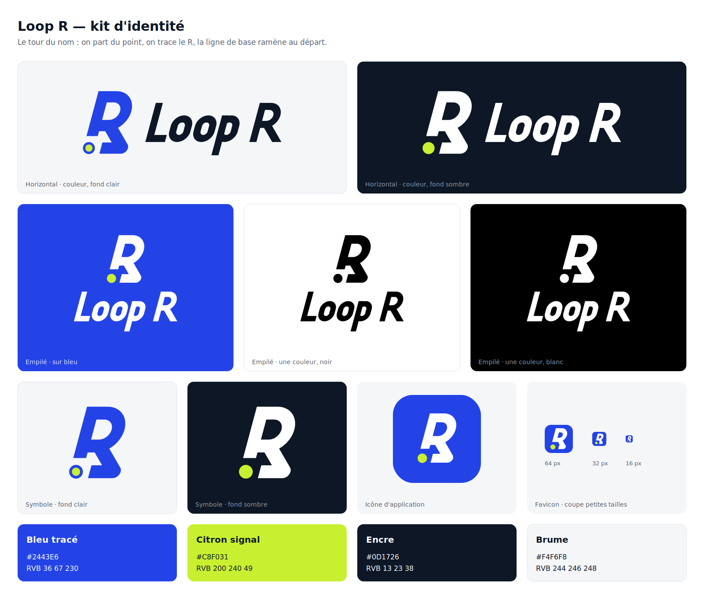

# Loop R — guide d'usage du logo



## L'idée

**Le tour du nom.** Un seul trait part du point de départ, monte, dessine le R, s'élance dans la jambe,
et la ligne de base le ramène au point, sans repasser par le même chemin. Le fût et la ligne de base
forment un **L**, le reste le **R** : le nom entier tient dans une boucle, comme les parcours de l'app.

Le point de départ est l'élément signature : c'est le seul élément citron, et il ne touche jamais le trait.

## Les fichiers

Tous les SVG sont en contours pleins (aucun trait, aucune police, aucune transformation),
générés par `construire.py`. Ne pas les retoucher à la main : modifier le script et relancer.

| Dossier / fichier | Contenu |
|---|---|
| `svg/loopr-horizontal-*.svg` | Symbole + nom côte à côte — **version principale** |
| `svg/loopr-empile-*.svg` | Symbole au-dessus, nom dessous — formats carrés, écrans de lancement |
| `svg/loopr-symbole-*.svg` | Symbole seul, 24 px et plus |
| `svg/loopr-symbole-petit-*.svg` | Coupe petites tailles : trait plus fin, espaces et point plus grands — 16 à 24 px |
| `svg/loopr-lettrage-*.svg` | Le nom seul, quand le symbole est déjà présent ailleurs |
| `icones/app-icon.svg` + `png/app-icon-{1024,512,192,180}.png` | Icône d'application pleine page (Android et iOS arrondissent eux-mêmes) |
| `icones/app-icon-arrondie.svg` + `png/app-icon-arrondie-512.png` | Icône déjà arrondie, pour les présentations et le web |
| `icones/favicon.svg`, `favicon.ico`, `png/favicon-{16,32,48}.png` | Favicon, construit sur la coupe petites tailles |
| `planche.svg` / `planche.png` | Planche de présentation |

Chaque forme existe en cinq déclinaisons :

| Suffixe | Pour | Symbole | Point | Nom |
|---|---|---|---|---|
| `couleur-clair` | fonds clairs (blanc, Brume) | Bleu tracé | citron cerclé de bleu | Encre |
| `couleur-sombre` | fonds sombres (Encre, photo sombre) | blanc | citron | blanc |
| `sur-bleu` | fond Bleu tracé | blanc | citron | blanc |
| `noir` | impression une couleur, tampon, gravure | noir | noir | noir |
| `blanc` | une couleur en réserve sur fond foncé | blanc | blanc | blanc |

Pourquoi le point est cerclé sur fond clair : le citron seul sur blanc fait un contraste de 1,3:1 et disparaît.
Ne jamais poser le point citron sans cercle sur un fond clair.

## Couleurs

| Nom | HEX | RVB | CMJN (indicatif) | Rôle |
|---|---|---|---|---|
| **Bleu tracé** | `#2443E6` | 36 67 230 | 84 71 0 10 | Couleur de marque : symbole, fond d'icône |
| **Citron signal** | `#C8F031` | 200 240 49 | 17 0 80 6 | Le point de départ, et seulement lui |
| **Encre** | `#0D1726` | 13 23 38 | 66 40 0 85 | Le nom sur fond clair, fond sombre |
| **Brume** | `#F4F6F8` | 244 246 248 | 2 1 0 3 | Fond clair |

Les valeurs CMJN sont une conversion directe : à faire valider sur épreuve par l'imprimeur,
qui choisira aussi les Pantone les plus proches sur nuancier.

Contrastes mesurés (WCAG) : Bleu sur blanc 6,95:1 · blanc sur Bleu 6,95:1 · citron sur Bleu 5,29:1 ·
citron sur Encre 13,7:1 · Encre sur Brume 16,6:1. À éviter : Bleu sur Encre (2,6:1), citron sur blanc (1,3:1).

## Zone de protection

Autour du logo, laisser vide **un diamètre du point de départ** (noté *p*) de chaque côté.
Les fichiers SVG incluent déjà cette marge : ne pas les recadrer plus serré.

```
        p
    ┌────────────────────────┐
  p │  ●R  Loop R            │ p
    └────────────────────────┘
        p
```

## Tailles minimales

| Version | Écran | Impression |
|---|---|---|
| Horizontal | 96 px de large | 25 mm de large |
| Empilé | 64 px de haut | 18 mm de haut |
| Symbole | 24 px | 7 mm |
| Coupe petites tailles | 16 à 24 px | 4 à 7 mm |

En dessous de 24 px, utiliser **toujours** la coupe petites tailles (`symbole-petit`, `favicon`).

## Typographie

- **Le nom « Loop R » est un lettrage dessiné**, pas une police : condensé, une seule graisse,
  « o » en pistes d'athlétisme (deux droites, deux virages), incliné à 15° comme le symbole.
  Toujours utiliser les fichiers, ne jamais le recomposer au clavier.
- Le **R du nom est le même que celui du symbole** : même panse, même jambe à 60°.
- Textes d'accompagnement (déjà dans l'app, licence OFL, dossier `polices/`) :
  - titres : **Barlow Condensed** ExtraBold ou SemiBold ;
  - texte courant : **Atkinson Hyperlegible** Regular et Bold.

## Construction (pour référence)

- Inclinaison : 15° pour tout (fûts, lettrage), autour de la ligne de base.
- Jambe du R : 60° une fois inclinée, identique dans le symbole et le nom.
- Graisse : 18 % de la hauteur de capitale.
- Point de départ : diamètre ≈ 1,07 graisse, séparé du trait par un écart égal à son rayon.
- Le symbole horizontal et empilé mesure 1,6 hauteur de capitale du nom.

## À ne pas faire

- Changer les couleurs, ou mettre du citron ailleurs que sur le point.
- Coller le point au trait, le déplacer, ou le supprimer.
- Redresser, déformer, contourner, ombrer ou mettre un dégradé sur le logo.
- Recomposer le nom avec une police, ou changer la taille relative symbole/nom.
- Poser le logo couleur sur une photo chargée : utiliser `blanc` ou `noir`.
- Utiliser le symbole normal sous 24 px.

## Avant un usage public

Faire une recherche d'antériorité de marque (INPI / EUIPO, et recherche d'image inversée) par un professionnel :
ce kit ne garantit pas que le nom ou le signe soient disponibles.
