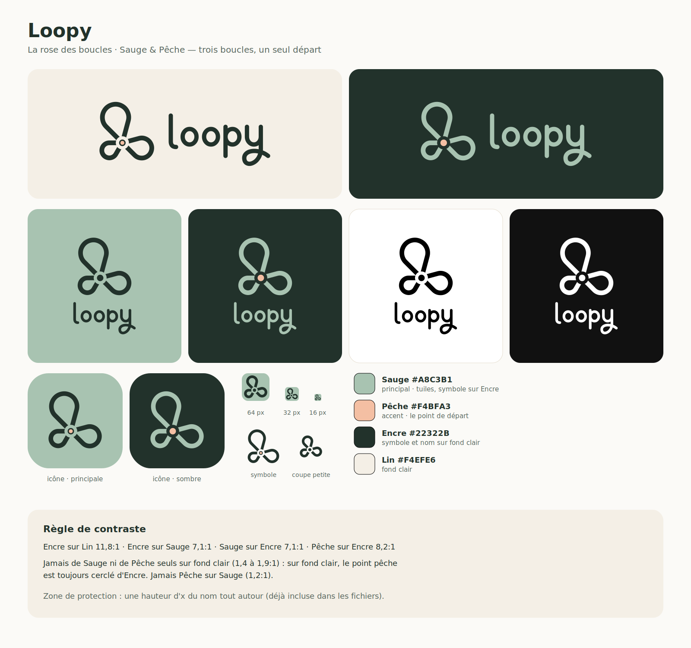

# Loopy — guide d'usage du logo

## Le nom

**Loopy** : en anglais, *loop* (la boucle) et *loopy* (un peu fou, joyeusement décalé).
Le nom est léger et souriant, l'opposé du ton « performance » des apps de course.
Il se prononce « loupi ». Il s'écrit toujours en minuscules dans le logo, et avec une capitale dans un texte : « Loopy ».

## L'idée

**La rose des boucles.** Trois boucles de longueurs différentes partent du même point et y reviennent,
comme les parcours que l'app propose autour de toi. Le point de départ, au centre, ne touche jamais les boucles :
c'est l'élément signature, et le seul qui porte la couleur Pêche.

## Les fichiers

Tous les SVG sont en contours pleins : aucun trait, aucune police, aucune transformation.
Ils sont générés par `construire.py`. Pour changer quelque chose, modifier le script et le relancer, sans retoucher les fichiers à la main :
`pip install skia-pathops fonttools cairosvg pillow` puis `python logo/kit/construire.py`.

| Fichier | Contenu |
|---|---|
| `svg/loopy-horizontal-*.svg` | Symbole + nom côte à côte : **version principale** |
| `svg/loopy-empile-*.svg` | Symbole au-dessus, nom dessous : formats carrés, écran de lancement |
| `svg/loopy-symbole-*.svg` | Symbole seul, 24 px et plus |
| `svg/loopy-symbole-petit-*.svg` | Coupe petites tailles (16 à 24 px) : trait plus gras, petite boucle agrandie, point plein |
| `svg/loopy-lettrage-*.svg` | Le nom seul |
| `icones/app-icon.svg` + `png/app-icon-{1024,512,192,180}.png` | Icône d'app pleine page, tuile Sauge (le système arrondit lui-même) |
| `icones/app-icon-arrondie.svg`, `app-icon-sombre*.svg` | Icône déjà arrondie, et icône sur tuile Encre |
| `icones/favicon.svg`, `favicon.ico`, `png/favicon-{16,32,48}.png` | Favicon, sur la coupe petites tailles |
| `../icone.png`, `../lancement.png` | Icône Android et écran de lancement de l'app (`buildozer.spec`) |

Chaque forme existe en cinq déclinaisons :

| Suffixe | Pour | Symbole | Point de départ | Nom |
|---|---|---|---|---|
| `couleur-clair` | Lin, blanc, tuile Sauge | Encre | cœur Pêche cerclé d'Encre | Encre |
| `encre` | une couleur sur fond clair ou pastel | Encre | Encre | Encre |
| `sombre` | fond Encre ou photo sombre | Sauge | Pêche plein | Sauge |
| `noir` | impression une couleur, tampon, gravure | noir | noir | noir |
| `blanc` | une couleur en réserve sur fond foncé | blanc | blanc | blanc |

## Couleurs

| Nom | HEX | RVB | CMJN (indicatif) | Rôle |
|---|---|---|---|---|
| **Sauge** | `#A8C3B1` | 168 195 177 | 14 0 9 24 | Couleur principale : tuile d'icône, symbole sur fond Encre |
| **Pêche** | `#F4BFA3` | 244 191 163 | 0 22 33 4 | Le point de départ, et seulement lui |
| **Encre** | `#22322B` | 34 50 43 | 32 0 14 80 | Symbole et nom sur fond clair, fond sombre |
| **Lin** | `#F4EFE6` | 244 239 230 | 0 2 6 4 | Fond clair |

Les valeurs CMJN sont une conversion directe. Elles sont à valider sur épreuve avec l'imprimeur, qui choisira aussi les Pantone.

### Règle de contraste

Contrastes mesurés selon la norme WCAG :

| Combinaison | Contraste | Usage |
|---|---|---|
| Encre sur Lin | 11,8:1 | autorisé |
| Encre sur Sauge | 7,1:1 | autorisé |
| Sauge sur Encre | 7,1:1 | autorisé |
| Pêche sur Encre | 8,2:1 | autorisé |
| Sauge sur blanc | 1,9:1 | **interdit** |
| Pêche sur Lin | 1,4:1 | **interdit** |
| Pêche sur Sauge | 1,2:1 | **interdit** |

- **Sur fond clair ou sur Sauge :** le symbole est en Encre, et la Pêche n'apparaît qu'en cœur du point de départ, cerclé d'Encre.
- **Sur fond Encre :** le symbole est en Sauge et le point de départ en Pêche plein.

### Dans l'app (`ui/widgets.py`)

Les pastels du logo ne suffisent pas pour du texte ou un tracé lisible en plein soleil.
L'app ajoute donc des tons fonctionnels de la même famille. Contrastes sur fond Lin, et la nuit sur fond `#121A16` :

| Rôle | Jour | Nuit |
|---|---|---|
| Boucle sur la carte, chiffres en vert | Sauge profonde `#2F5643` (7,2:1 ; 4,8:1 sur les rues, 4,3:1 sur les chemins) | Sauge `#A8C3B1` (9,4:1) |
| Bouton « signal » | fond Pêche, texte et contour Encre (8,2:1) | fond Pêche, texte Encre |
| Texte secondaire | `#4A5952` (6,5:1) | `#9FAEA5` (7,7:1) |
| Chemins sur la carte | sable `#C9B993`, pour que la boucle ne s'y confonde pas | `#544C3B` |

## Zone de protection

Autour du logo, laisser vide **une hauteur d'x du nom**, c'est-à-dire la hauteur du « o », de chaque côté.
Les fichiers SVG incluent déjà cette marge : ne pas les recadrer plus serré.

## Tailles minimales

| Version | Écran | Impression |
|---|---|---|
| Horizontal | 120 px de large | 30 mm de large |
| Empilé | 72 px de haut | 20 mm de haut |
| Symbole | 24 px | 7 mm |
| Coupe petites tailles | 16 à 24 px | 4 à 7 mm |

En dessous de 24 px, utiliser **toujours** la coupe petites tailles (`symbole-petit`, `favicon`).
Le cœur Pêche disparaît en petit : la coupe petites tailles a un point plein.

## Typographie

- **« loopy » est un lettrage dessiné**, pas une police. Ce sont des minuscules monolignes à bouts ronds, un peu condensées.
  Le l finit en crochet vers l'avant, comme une foulée. La queue du y fait une boucle, croise son fût et repart :
  le nom se termine comme le symbole commence.
  Sa graisse est réglée sur celle des boucles du symbole. Toujours utiliser les fichiers, ne jamais le recomposer au clavier.
- Textes d'accompagnement (licence OFL, dossier `polices/`) :
  - titres et chiffres : **Barlow Condensed** SemiBold ou ExtraBold ;
  - texte courant : **Atkinson Hyperlegible** Regular et Bold.

## Construction (pour référence)

Unités du symbole, y vers le bas, départ en (0, 0) :

| Boucle | Angle | Distance au bout | Rayon du bout |
|---|---|---|---|
| Grande | −105° | 84 | 42 |
| Moyenne | 15° | 64 | 32 |
| Petite | 150° | 48 | 24 |

- Le demi-angle de chaque goutte vaut 30° : toutes les droites tombent sur des multiples de 15°.
- Le trait mesure 15, le vide autour du départ a un rayon de 21, le point de départ un rayon de 10,5, et le cœur Pêche fait 60 % du point.
- Dans la version horizontale, le symbole est à l'échelle 0,95 du nom : les traits paraissent égaux.
  Dans la version empilée, il passe à 1,52 : c'est lui qui porte la composition, le nom se range dessous.

## À ne pas faire

- Poser de la Sauge ou de la Pêche seules sur un fond clair, ou la Pêche sur la Sauge.
- Mettre de la Pêche ailleurs que sur le point de départ.
- Coller le point aux boucles, le déplacer, ou faire pivoter le symbole (la grande boucle reste en haut).
- Déformer, contourner, ombrer ou mettre un dégradé sur le logo.
- Recomposer le nom avec une police, ou changer la taille relative entre symbole et nom.
- Utiliser le symbole normal sous 24 px.

## Avant un usage public

Recherche faite le 2 novembre 2026, sans garantie juridique :
- **« Loopy » est déjà une marque connue dans la musique :** Loopy et Loopy Pro, les loopers de A Tasty Pixel (iOS, et Android pour Loopy Pro).
  Ce n'est pas le même domaine que la course, mais c'est la même boutique d'applications et le même mot.
- **Domaines :** `loopy.com`, `.app`, `.fr`, `.io` et `.run` sont tous pris. `loopyrun.com` est libre.
- **Nom en boutique :** pour se distinguer, publier sous un nom complet comme « Loopy Run » ou « Loopy · boucles de course ».

À faire avant le lancement : une recherche d'antériorité de marque (INPI, EUIPO et WIPO, classes 9 et 42),
avec un avis sur le risque face à Loopy (classe 9, musique), puis le dépôt, et une recherche d'image inversée sur le symbole.
